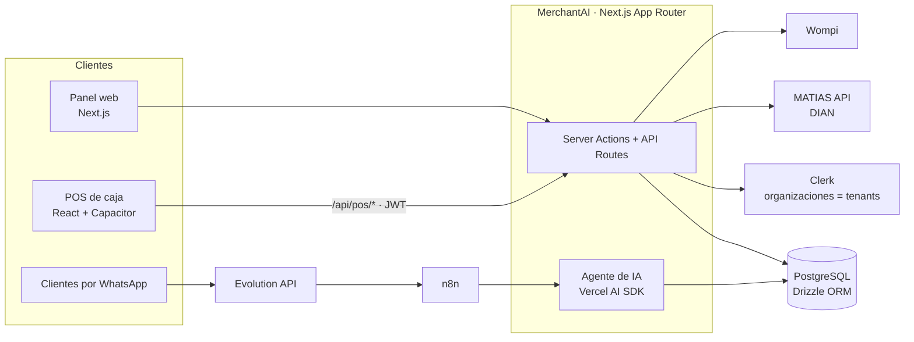

# MerchantAI

**El sistema operativo del pequeño comercio colombiano.** SaaS multi-tenant que reemplaza el cuaderno de la tienda: punto de venta, inventario FIFO, fiados, caja, delivery, facturación electrónica y un agente de IA que atiende por WhatsApp.

🌐 [mymerchantai.com](https://mymerchantai.com)


---

## El problema

Las tiendas de barrio, ferreterías, droguerías y misceláneas de Colombia siguen manejando ventas, inventario y fiados en un cuaderno o en Excel. No saben cuánto ganan de verdad, pierden mercancía por vencimiento y los créditos a clientes se les escapan. Además, desde 2026 la DIAN exige reportar cada venta POS en tiempo real.

## La solución

Una plataforma web pensada para el comerciante, no para el contador:

| Módulo | Qué resuelve |
|---|---|
| **Caja / POS** | Cobro con código de barras, pagos mixtos, venta por peso y cierre de caja |
| **Inventario FIFO** | Costo real por lote, vencimientos, alertas de stock y movimientos auditables |
| **Fiados** | Créditos con plazos, abonos y recordatorios automáticos por WhatsApp |
| **Delivery** | Pedidos con estados y notificaciones al cliente |
| **Empleados** | Cajeros con PIN, roles y permisos |
| **Reportes** | Ventas por periodo, cajero y método de pago; exportación a Excel y PDF |
| **Facturación electrónica** | Emisión a la DIAN mediante adaptador a MATIAS API |
| **Pagos y planes** | Planes y créditos de uso con Wompi |
| **Consola de operador** | Panel super-admin para gestionar todas las organizaciones |

### El agente de IA

- **Atiende 24/7 por WhatsApp**: responde, cotiza y toma pedidos con el catálogo real del negocio.
- **Responde en lenguaje natural**: "¿cuánto vendí esta semana?".
- **Detecta lo que se escapa**: productos por vencer, caídas de venta, posibles fraudes.
- **Pide aprobación**: las acciones sensibles requieren el PIN del dueño.

## Arquitectura



Ecosistema:

- **[merchantai](https://github.com/Samuel3945/merchantai)**: este repo, el núcleo (panel, API y agente).
- **[pos-merchatai](https://github.com/Samuel3945/pos-merchatai)**: POS de caja web y Android, offline-first.
- **[pagemerchantai](https://github.com/Samuel3945/pagemerchantai)**: landing pública y SEO.

## Calidad e ingeniería

- **+110 archivos de pruebas**: unitarias (Vitest), integración y E2E (Playwright).
- **96 migraciones** versionadas con Drizzle.
- **CI en GitHub Actions** con *semantic-release* y commits convencionales (commitlint + lefthook).
- **Observabilidad** con Sentry; internacionalización con next-intl.
- **Despliegue** con imagen Docker *standalone* en VPS (Easypanel); las migraciones corren al arrancar, con reintentos.

> Construido sobre [SaaS Boilerplate](https://github.com/ixartz/SaaS-Boilerplate) (MIT) como base técnica. Todo el dominio de negocio (POS, inventario FIFO, fiados, delivery, facturación, agente de IA y consola de operador) es desarrollo propio.

---

# Documentación técnica

## Tecnologías

- **Framework**: Next.js 15+ (App Router, RSC, Server Actions)
- **Base de datos**: PostgreSQL con Drizzle ORM (migraciones en `migrations/`)
- **Auth / multi-tenant**: Clerk (organizaciones = tenants)
- **IA**: Vercel AI SDK — modelos Anthropic y OpenAI
- **Estilo**: Tailwind CSS v4 + Radix UI + shadcn/ui
- **Internacionalización**: next-intl (`src/locales/`)

## Estructura de `src/`

```
src/
├── app/                        # Rutas Next.js App Router
│   ├── [locale]/
│   │   ├── (auth)/             # Rutas autenticadas
│   │   │   ├── dashboard/      # Panel principal del comercio
│   │   │   │   ├── products/   # Productos e inventario
│   │   │   │   ├── sales/      # Ventas
│   │   │   │   ├── inventory/  # Movimientos de stock (FIFO)
│   │   │   │   ├── fiados/     # Creditos a clientes
│   │   │   │   ├── customers/  # Clientes
│   │   │   │   ├── suppliers/  # Proveedores
│   │   │   │   ├── cash/       # Caja / arqueo
│   │   │   │   ├── delivery/   # Pedidos y delivery
│   │   │   │   ├── employees/  # Empleados
│   │   │   │   ├── reports/    # Reportes y exportacion
│   │   │   │   ├── ai-agent/   # Agente de IA (Modelos Inteligentes)
│   │   │   │   ├── plans/      # Planes y creditos
│   │   │   │   ├── settings/   # Configuracion del negocio
│   │   │   │   └── pos-cajeros/ # Tokens para cajas POS
│   │   │   ├── platform/       # Consola de operador (ver seccion /platform)
│   │   │   └── onboarding/     # Flujo de alta de organizacion
│   │   └── (marketing)/        # Landing publica
│   └── api/                    # API Routes
│       └── webhooks/           # Webhooks de Clerk y WhatsApp
├── actions/                    # Server Actions (llamados desde RSC y Client)
├── features/                   # Feature modules (logica de UI por dominio)
│   ├── dashboard/
│   ├── products/
│   ├── inventory/
│   ├── sales/
│   ├── fiados/
│   ├── delivery/
│   ├── cash/
│   ├── reports/
│   ├── ai-agent/
│   ├── billing/
│   ├── platform/
│   └── ...
├── libs/                       # Utilidades transversales
│   ├── DB.ts                   # Instancia Drizzle (singleton)
│   ├── platform/operator.ts    # Guard de acceso al operador (ver mas abajo)
│   ├── fifo-cogs.ts            # Consumo de lotes FIFO
│   ├── sale-returns.ts         # Devoluciones de ventas
│   ├── smart-stock.ts          # Heuristica de stock minimo
│   ├── audit-log.ts            # Registro de auditoria
│   └── ...
├── models/
│   └── Schema.ts               # Esquema Drizzle (tablas y relaciones)
├── locales/                    # Traducciones (next-intl)
│   ├── en/
│   └── es/
└── components/                 # Componentes compartidos (shadcn/ui en ui/)
```

## Ruta `/platform` — Consola del operador

`/platform` es el plano super-admin de MerchantAI. Tiene acceso de lectura y escritura a datos de **todas** las organizaciones.

El acceso **no** usa roles de Clerk. Esta controlado por una lista de acceso explicita en `src/libs/platform/operator.ts`, resuelta en este orden:

1. `PLATFORM_OPERATOR_USER_IDS` — Clerk user IDs separados por coma (maxima precedencia).
2. `PLATFORM_OPERATOR_EMAILS` — emails verificados en Clerk, separados por coma.
3. Fallback hardcodeado al email del dueno (funciona antes de que existan las variables en el VPS).

Funciones clave:

- `getPlatformOperator()` — resuelve si la sesion actual es operador; retorna `null` si no.
- `requirePlatformOperator()` — lanza excepcion si no es operador (usado en Server Actions y data access).

## Despliegue — Easypanel VPS + Docker standalone

El Dockerfile compila una imagen `standalone` de Next.js. Las variables de entorno **no vienen de archivos `.env`** — no existen en el repositorio. Toda la configuracion vive en el entorno del VPS (Easypanel).

Las migraciones de base de datos se ejecutan al iniciar el contenedor mediante `scripts/db-migrate.mjs` (usa `drizzle-orm/node-postgres` directamente, sin `drizzle-kit`). El script reintenta con backoff exponencial si la base de datos todavia no esta disponible al arrancar.

```bash
# El entrypoint del contenedor hace (simplificado):
node scripts/db-migrate.mjs && node server.js
```

## Variables de entorno (VPS)

No existen archivos `.env` en este repositorio. Configurar todas las variables directamente en Easypanel.

Las marcadas como **ARG de build** deben estar disponibles en el momento de construir la imagen Docker (se pasan como `--build-arg`).

| Variable | Requerida | ARG de build | Proposito |
|---|---|---|---|
| `DATABASE_URL` | **Si** | No | Cadena de conexion PostgreSQL |
| `CLERK_SECRET_KEY` | **Si** | No | Clave secreta de Clerk (server-side) |
| `NEXT_PUBLIC_CLERK_PUBLISHABLE_KEY` | **Si** | **Si** | Clave publica de Clerk (client-side) |
| `NEXT_PUBLIC_APP_URL` | **Si** | **Si** | URL publica de la app (sin trailing slash) |
| `OPENAI_API_KEY` | Opcional | No | Modelos OpenAI — unica IA del sistema (categorizacion, import, agente de WhatsApp) |
| `BLOB_READ_WRITE_TOKEN` | Opcional | No | Vercel Blob (subida de archivos) |
| `RESEND_API_KEY` | Opcional | No | Envio de emails transaccionales |
| `RESEND_FROM_EMAIL` | Opcional | No | Direccion remitente para Resend |
| `EVOLUTION_API_URL` | Opcional | No | URL de la instancia Evolution API (WhatsApp) |
| `EVOLUTION_API_KEY` | Opcional | No | API key de Evolution API |
| `EVOLUTION_INSTANCE` | Opcional | No | Nombre de la instancia WhatsApp |
| `WHATSAPP_WEBHOOK_TOKEN` | Opcional | No | Token de verificacion del webhook de WhatsApp |
| `WHATSAPP_DEFAULT_ORG_ID` | Opcional | No | Org Clerk por defecto para mensajes WhatsApp entrantes sin org |
| `WHATSAPP_N8N_WEBHOOK_URL` | Opcional | No | Webhook n8n compartido al que cada canal de WhatsApp reenvia los mensajes entrantes (Ajustes -> WhatsApp). n8n mapea a la org desde el campo `instance` |
| `CRON_SECRET` | Opcional | No | Token para autenticar llamadas de cron jobs |
| `PLATFORM_OPERATOR_EMAILS` | Opcional | No | Emails del operador de plataforma (CSV) |
| `PLATFORM_OPERATOR_USER_IDS` | Opcional | No | Clerk user IDs del operador de plataforma (CSV) |
| `NEXT_PUBLIC_LOGGING_LEVEL` | Opcional | **Si** | Nivel de log del cliente (`debug`/`info`/`warning`/`error`) |
| `RUN_MIGRATIONS` | Opcional | No | Si es `true`, el entrypoint ejecuta las migraciones al iniciar |
| `PORT` | Opcional | No | Puerto del servidor (default `3000`) |
| `HOSTNAME` | Opcional | No | Hostname del servidor (default `0.0.0.0`) |

## Desarrollo local

```bash
# Instalar dependencias
npm install

# Iniciar servidor de desarrollo (Next.js + PGlite local)
npm run dev

# Typecheck
npm run check:types

# Tests unitarios
npm run test

# Tests E2E
npm run test:e2e

# Generar migraciones Drizzle (despues de cambiar Schema.ts)
npm run db:generate

# Ejecutar migraciones contra DATABASE_URL
npm run db:migrate
```

Para desarrollo local, la base de datos se levanta automaticamente con PGlite en memoria
(`npm run dev` lanza `pglite-server` + Next.js en paralelo). Para conectar a una PostgreSQL
real, configurar `DATABASE_URL` en el entorno del shell antes de correr los comandos.

---

Desarrollado por **[Samuel Alzate](https://github.com/Samuel3945)** · Cartagena, Colombia
